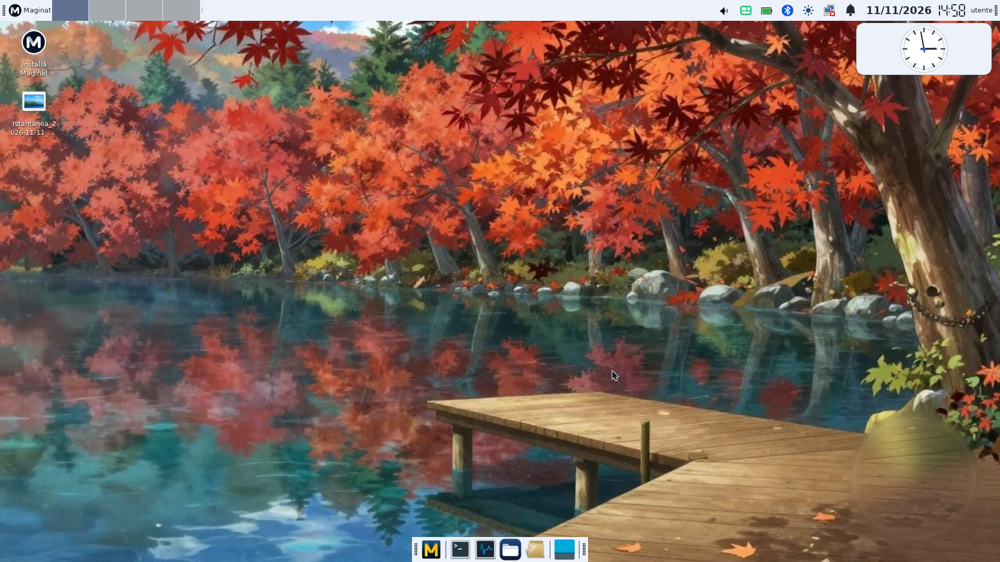
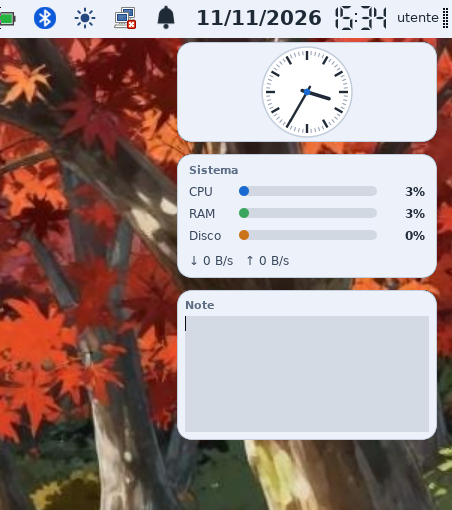
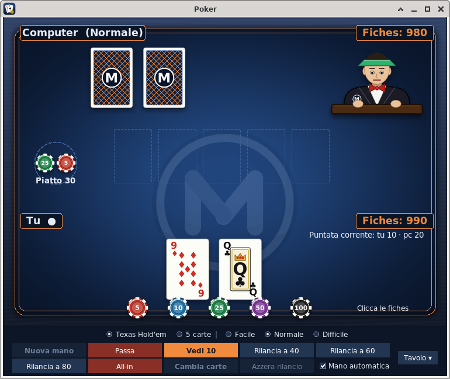
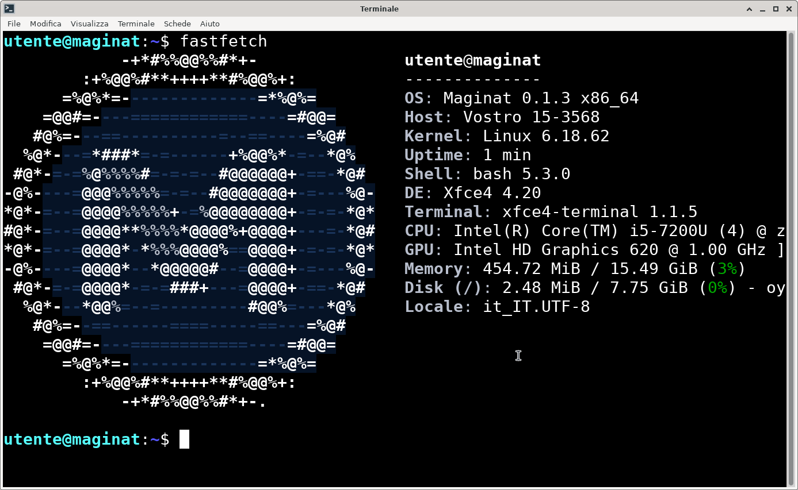
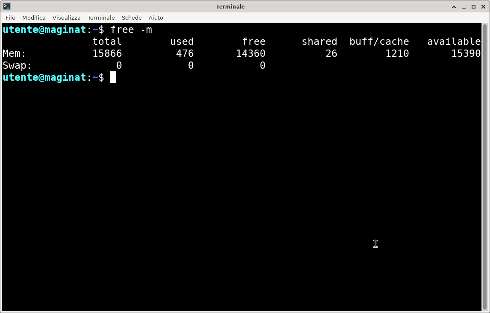

# Maginat

Una distribución Linux independiente construida desde cero siguiendo **Linux From Scratch 12.4** (init SysV, sin systemd), con el escritorio **Xfce**.

**Última versión: [0.1.3](https://github.com/Aleps31/Maginat/releases/tag/v0.1.3)** · Sitio web: https://aleps31.github.io/Maginat/ · English: [README.md](README.md) · Italiano: [README.it.md](README.it.md)

## Estado

Maginat 0.1.3 es una versión oficial de un proyecto joven (serie 0.x). Se ha probado en máquinas virtuales (BIOS, UEFI y UEFI con Secure Boot; sesión live e instalación en un disco entero, junto a otro sistema, en el espacio libre de un disco, cifrada y portátil en una memoria USB); la sesión live también funcionó, con Secure Boot activado, en un Dell Vostro 15-3568 (gráficos Intel).

## Capturas de pantalla

## Qué incluye

- Xfce con tema, cursores, barra superior y dock personalizados; 44 fondos de pantalla
- Mullvad Browser, LibreOffice, Tutanota Desktop, mtPaint (Thunderbird y muchas más aplicaciones están a un clic en la Tienda)
- Widgets del escritorio a elegir: reloj, calendario, tiempo, monitor del sistema, batería y red, accesos rápidos, notas
- Impresión y escaneo: impresoras y escáneres sin controlador (USB y red), además de los controladores HPLIP (solo impresión), brlaser (Brother) y splix (Samsung, Xerox, Dell, Lexmark, Toshiba)
- Wi-Fi, Bluetooth, sonido y gestión de energía; cortafuegos activo por defecto
- Tienda de Maginat (Flatpak/Flathub) y Actualizar Maginat
- Juegos Veintiuna y Póker
- Instalador gráfico para BIOS y UEFI, con presentación y barra de progreso real: borra un disco entero, usa una partición existente, usa el espacio libre de un disco (no se borra nada) o instala en una memoria USB que arranca en cualquier PC; cifrado de disco opcional (LUKS2)
- Interfaz en inglés, italiano y español

## Novedades de la 0.1.3

- **Secure Boot**: shim y GRUB firmados (de Ubuntu 24.04), kernel firmado con la clave de Maginat; la clave se registra una vez por equipo (ver abajo)
- **Lockdown del kernel** activado; kernel Linux 6.18.62 LTS recompilado con soporte USB Attached SCSI (UAS) y con los controladores Wi-Fi Broadcom más antiguos (b43, brcmsmac) como módulos
- **Actualizaciones de seguridad** ya en la ISO (misma serie que antes, solo correcciones): kernel Linux 6.18.62, OpenSSL 3.5.9, curl 8.23.0, OpenSSH 10.6p2, libpng 1.6.59, xz 5.8.4, git 2.47.3, zlib 1.3.2, Python 3.13.18
- **Español** añadido: interfaz, aplicaciones, juegos, instalador y teclado. El idioma se elige en la primera pantalla del arranque
- **Sesión live como en otras distribuciones**: arranca directamente el escritorio con el icono "Instalar Maginat" (sin menú de texto)
- Nuevo **menú de arranque**: Maginat, con persistencia, gráficos seguros, compatibilidad, configuración del firmware
- **Instalador flexible**: disco entero, partición existente, **espacio libre junto a otro sistema (arranque dual)**, **reducción de una partición Windows o Linux para hacer espacio (experimental)** o **instalación portátil** en una memoria USB (BIOS y UEFI); los otros sistemas encontrados en el disco se añaden al menú de arranque
- **Cifrado de disco (LUKS2)**, opcional en un disco entero, en una partición existente (con una pequeña partición separada para `/boot`), en el espacio libre o en una memoria USB portátil: la contraseña se pide en cada arranque; una **clave de recuperación** (16 caracteres) se muestra durante la instalación y también desbloquea el disco
- **Actualizaciones del sistema** en Actualizar Maginat: paquetes firmados (incluido el kernel), kernel anterior conservado como respaldo, **"Deshacer la última actualización"**, comprobación diaria con notificación (pregunta una vez, solo en el sistema instalado)
- **Versiones nuevas de Maginat sin nueva ISO**: Actualizar Maginat puede llevar la 0.1.3 a las versiones siguientes con un paquete firmado; los ajustes que hayas cambiado se conservan (la versión nueva se guarda al lado como `.nuovo-…`) y la actualización se puede deshacer
- Aviso cuando una tarjeta Wi-Fi necesita un firmware que no está instalado, más la utilidad **Firmware Wi-Fi Broadcom** en el menú que lo descarga e instala (hace falta otra conexión a Internet)
- Utilidad **Complemento de impresoras HP** en el menú: descarga en tu equipo el complemento propietario de HP (necesario para algunas impresoras), comprueba su firma e integridad, muestra la licencia de HP y lo instala (aún no probada con una impresora HP real)
- Los iconos de las aplicaciones Flatpak ahora se ven correctamente (los iconos SVG se convierten automáticamente)
- **Widgets del escritorio** rediseñados, ventanas y menús claros, 44 fondos (eran 26), "M" animada antes de la pantalla de inicio de sesión, nuevos gráficos de Veintiuna y Póker
- Thunderbird ya no está en la ISO (sigue en la Tienda); ISO de unos 1,4 GB
- RAM en reposo: unos **270 MB** en una máquina virtual y unos **600 MB** en un portátil real (sesión live); unos **4,1 GB** de disco tras la instalación

## Descarga e instalación

Descarga la ISO desde la página de [Releases](https://github.com/Aleps31/Maginat/releases), verifica su SHA-256 (`sha256sum -c SHA256SUMS`), grábala en una memoria USB (4 GB o más) y arranca desde ella. Requisitos: PC x86-64-v2 (procesador de 2009 aproximadamente o más reciente), 2 GB de RAM (se recomiendan 4 GB), al menos 20 GB de disco para instalar.

| Archivo | Notas |
|---|---|
| maginat-0.1.3.iso | live + instalador arrancable, unos 1,4 GB |
| maginat-sviluppo-0.1.3.tar.xz | herramientas de desarrollo, las descarga la Tienda (no cambiar el nombre) |
| maginat-0.1.3-sources.tar | fuentes de los paquetes nuevos o modificados, configuración del kernel |
| SHA256SUMS | sumas de verificación |

En la sesión live el usuario es `utente` y la contraseña es `maginat` (solo hace falta para desbloquear la pantalla).

### Secure Boot

Maginat arranca con Secure Boot activado. La primera vez en cada equipo hay que registrar la clave de Maginat (queda en el firmware y vale también para el sistema instalado):

1. Arranca la ISO. Un mensaje explica lo que ocurre y después aparece una **pantalla azul (MokManager)**: pulsa una tecla en 10 segundos.
2. Elige **Enroll key from disk**, selecciona `maginat-sb.cer` y después **Continue**, **Yes**, **Reboot**.
3. Arranca la ISO otra vez: ahora inicia con normalidad.

Alternativas: probarla en una máquina virtual o desactivar Secure Boot en la configuración del firmware. Si tu PC usa **BitLocker** o cifrado del dispositivo, cambiar la configuración de Secure Boot puede hacer que Windows pida la clave de recuperación en el siguiente arranque: téngala a mano o elige la primera opción.

## Menú de arranque

1. **Maginat 0.1.3**: arranque normal (abre el registro de la clave si hace falta)
2. **Con persistencia**: conserva tus archivos en la memoria USB (`sudo maginat-persistenza`)
3. **Gráficos seguros**: para pantallas que se quedan en negro
4. **Compatibilidad**: opciones adicionales para hardware antiguo o poco habitual
5. **Configuración del firmware**: abre la configuración UEFI (solo UEFI)

## Limitaciones conocidas

- Secure Boot: la clave de Maginat debe registrarse una vez por equipo. El kernel funciona en modo lockdown: los módulos sin firmar (por ejemplo los controladores propietarios de NVIDIA o los módulos de host de VirtualBox) no se pueden cargar y no hay hibernación
- Cifrado de disco (LUKS2): si olvidas la contraseña y pierdes la clave de recuperación los datos no se pueden recuperar; `/boot` no está cifrada; para cifrar una partición existente hace falta una segunda partición (al menos 512 MiB) en el mismo disco para `/boot`
- La reducción de una partición (opción 5 del instalador) es **experimental**: funciona con particiones NTFS (Windows) y ext2/3/4 y conserva sus archivos, pero un corte de luz o un error aún pueden causar pérdida de datos, así que haz antes una copia de seguridad. Rechaza BitLocker, Windows hibernado (inicio rápido) y sistemas de archivos con errores; en esos casos libera tú el espacio desde el otro sistema (con BitLocker, suspéndelo antes)
- La contraseña del disco se escribe con la distribución elegida en la instalación (27 distribuciones, sobre todo europeas); con otros teclados (por ejemplo griego, cirílico, lituano, letón, rumano) elige US y escríbela como en un teclado estadounidense. Solo puede contener letras sin acentos, dígitos y símbolos comunes
- Aún no compatible: controladores propietarios de NVIDIA, Wi-Fi Broadcom `wl` y lectores de huellas (previstos para la 0.1.4)
- Instalar junto a otro sistema modifica la tabla de particiones (el modo de espacio libre solo añade particiones): haz antes una copia de los datos importantes
- Algunas tarjetas Wi-Fi Broadcom antiguas necesitan un firmware que no se puede redistribuir (b43): Maginat avisa cuando falta y ofrece la utilidad **Firmware Wi-Fi Broadcom** (menú) para descargarlo, que necesita otra conexión a Internet (Ethernet o conexión compartida por USB del teléfono)
- Las actualizaciones cubren las aplicaciones Flatpak, los paquetes de sistema firmados y las versiones nuevas de Maginat (sin nueva ISO); los ajustes ya guardados en tu carpeta personal (panel, fondo) no se cambian con una actualización de versión
- Algunas impresoras HP necesitan un complemento propietario de HP (no redistribuible): Maginat no lo contiene, pero la utilidad **Complemento de impresoras HP** (menú) lo descarga, comprueba su firma y lo instala (hace falta Internet; aún no probada con una impresora HP real)
- Software experimental: no lo uses en equipos con datos que no puedas perder sin una copia de seguridad

## Código fuente

Nuestros scripts de construcción y la configuración están en `build/`, `system/` y en las carpetas de cada versión (`0.1.1/`, `0.1.2/`, `0.1.3/`: scripts en `build/` y archivos en `overlay/`). Los archivos de fuentes se adjuntan a cada release: las fuentes base están en la release 0.1, los paquetes más recientes en las siguientes. Los binarios oficiales proceden de los proyectos originales que figuran en el archivo de fuentes.

## Créditos

Diseñado y creado por **Alessandro Pisanu ("Aleps31")**, que construyó la base LFS y diseñó e integró todo el sistema. El código Python, C y shell se escribió y corrigió junto con Claude (Anthropic).

## Licencia

Copyright (C) 2026 Alessandro Pisanu ("Aleps31"). Código original: GPL-2.0 (ver `LICENSE` y `COPYRIGHT`). Quien copie, modifique o redistribuya Maginat debe mantener esta nota de copyright y el texto de la licencia, y publicar las fuentes. El nombre "Maginat", el logo y las claves de firma no están cubiertos por la licencia: una versión modificada debe usar otro nombre y no puede firmar actualizaciones para Maginat. Cada paquete conserva su propia licencia (ver `LICENZE.txt` en el sistema).

## Aviso

Maginat no está afiliada a los proyectos que incluye.
