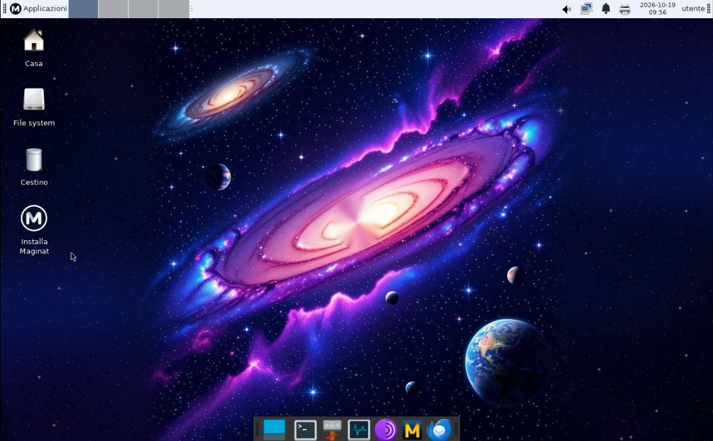
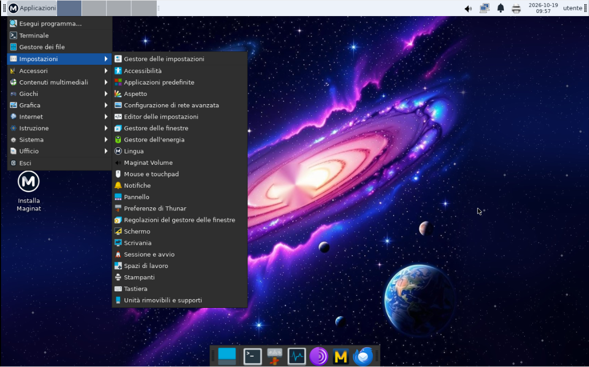
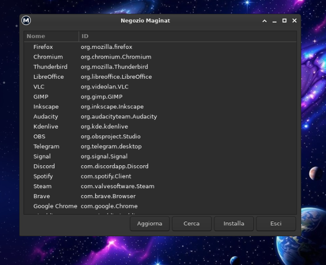

# Maginat

Maginat è una distribuzione Linux indipendente costruita da zero, seguendo
[Linux From Scratch](https://www.linuxfromscratch.org/) 12.4 (SysV init), con il desktop Xfce.

English version: [README.md](README.md)

> **Stato: anteprima 0.1.1.** Provata in macchine virtuali e su un portatile reale (Dell Vostro 15-3568).
> Aspettati qualche difetto. Vedi i [Limiti noti](#limiti-noti).

## Schermate

## Cosa include

- Desktop Xfce, con un tema personalizzato, una barra in alto (volume, rete, notifiche, stampanti, batteria, Bluetooth) e un dock
- Mullvad Browser, Thunderbird, LibreOffice e Tutanota Desktop
- Stampa e scansione con strumenti grafici (CUPS, SANE)
- Wi-Fi, Bluetooth, audio e gestione dell'energia
- Firewall attivo di default
- Negozio Maginat: uno strumento grafico per installare altre applicazioni
- Programma di installazione grafico per computer BIOS e UEFI, con interfaccia in italiano e inglese

## Novità della 0.1.1

- Firewall attivo di default (nftables): blocca le connessioni in ingresso
- Driver grafici aggiornati (Mesa 25.1.8 con LLVM 20): Intel (iris, crocus, i915), AMD (radeonsi, r300, r600), NVIDIA (nouveau), macchine virtuali (virgl) e rendering software (llvmpipe)
- Microcode della CPU Intel e AMD caricato all'avvio
- Sincronizzazione automatica dell'ora (chrony)
- Stampanti e scanner: nuovi strumenti grafici, lanciatore nella barra in alto
- Blocco schermo (Applicazioni, Esci, Blocca schermo)
- TRIM automatico settimanale per gli SSD (solo sistema installato)
- Installazione su disco intero o su partizione esistente, BIOS e UEFI
- L'icona "Installa Maginat" non compare più nel sistema installato

Provata su QEMU (installazioni BIOS e UEFI) e su un Dell Vostro 15-3568 (Intel HD Graphics 620), in live: Wi-Fi, Bluetooth, batteria, grafica, luminosità, sospensione e aggiornamento del microcode.

## Download

Scarica l'ISO dalla pagina [Releases](../../releases) e controllala con lo SHA-256 indicato nelle note di rilascio.

## Provarla o installarla

Scrivi l'ISO su una chiavetta USB e avvia da lì. Scegli "Prova Maginat senza installare" per usare il sistema live, oppure "Installa Maginat sul disco" per installarlo. Il programma di installazione può usare un disco intero (cancellandolo) o una partizione esistente. Il Secure Boot deve essere disattivato.

## Limiti noti

- Niente Secure Boot
- Nessuna voce di avvio "grafica sicura" (prevista per la 0.1.2)
- "Esci" nella sessione live può lasciare lo schermo nero finché non premi un tasto
- I tasti Fn del volume non cambiano il volume; usa l'icona nella barra
- L'icona della batteria è solo un indicatore
- Niente driver stampante proprietari (HPLIP), stampa USB senza driver (ipp-usb) né scansione di rete (airscan)
- Sperimentale: provala prima in una macchina virtuale o dalla chiavetta live

## Codice sorgente

Le cartelle `build/` e `system/` contengono gli script di costruzione e i file di personalizzazione. Gli archivi dei sorgenti dei pacchetti sono allegati a ogni release: `maginat-0.1-sources.tar` e `maginat-0.1.1-sources.tar` (pacchetti nuovi e modificati). La licenza di ogni pacchetto è inclusa nella ISO, in `/usr/share/licenses`. La cartella `0.1.1/` contiene i file nuovi e modificati della versione 0.1.1: `overlay/` (script, sorgenti C, file di configurazione) e `build/` (script di costruzione dell'immagine e della ISO).

Programmi distribuiti come binari ufficiali, il cui codice sorgente è disponibile dai progetti originali:
- LibreOffice 26.8.1 (MPL-2.0): https://www.libreoffice.org/download/source-code/
- Mullvad Browser 15.0.24: https://github.com/mullvad/mullvad-browser
- Thunderbird 157.0.1 (MPL-2.0): https://ftp.mozilla.org/pub/thunderbird/releases.

## Crediti

Creata da Aleps31: la base Linux From Scratch, il codice Python e l'integrazione del desktop. Script sviluppati con Claude (Anthropic).

## Licenza

Il codice originale in questo repository è rilasciato con licenza GPL-2.0 (vedi `LICENSE`). Ogni pacchetto mantiene la propria licenza.

## Avvertenza

Maginat è un progetto indipendente e non è affiliato ai progetti elencati sopra.
