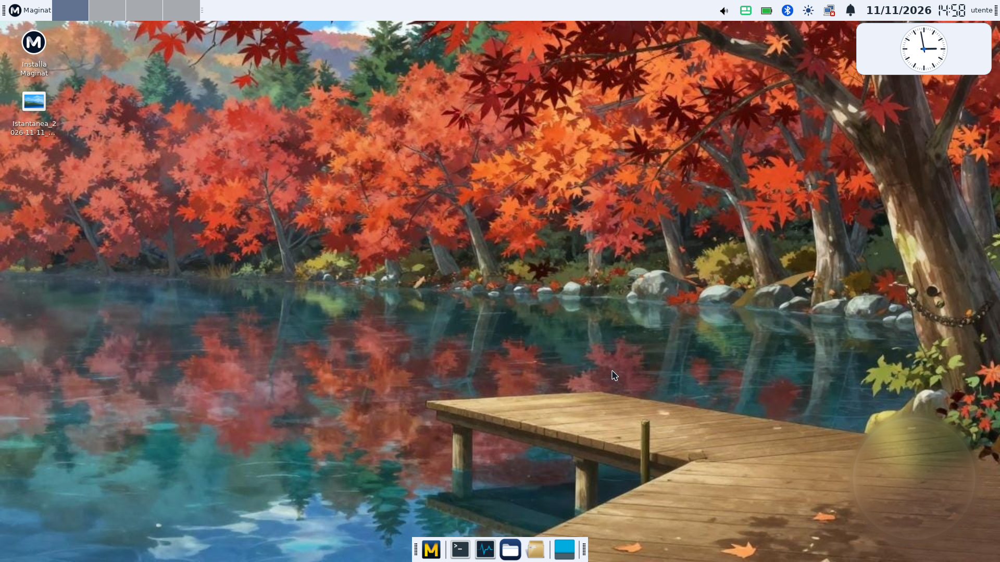
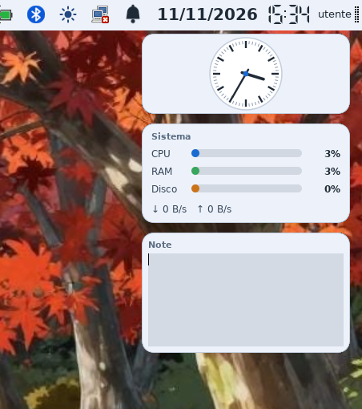
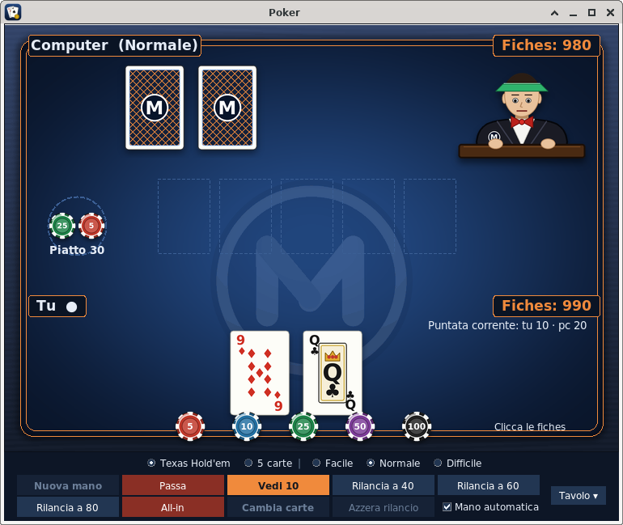
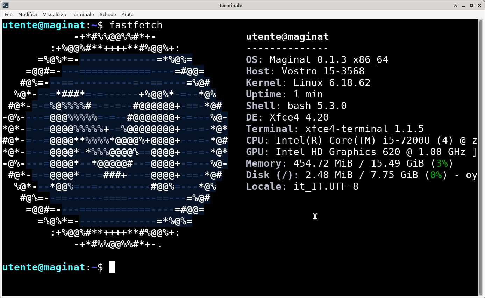
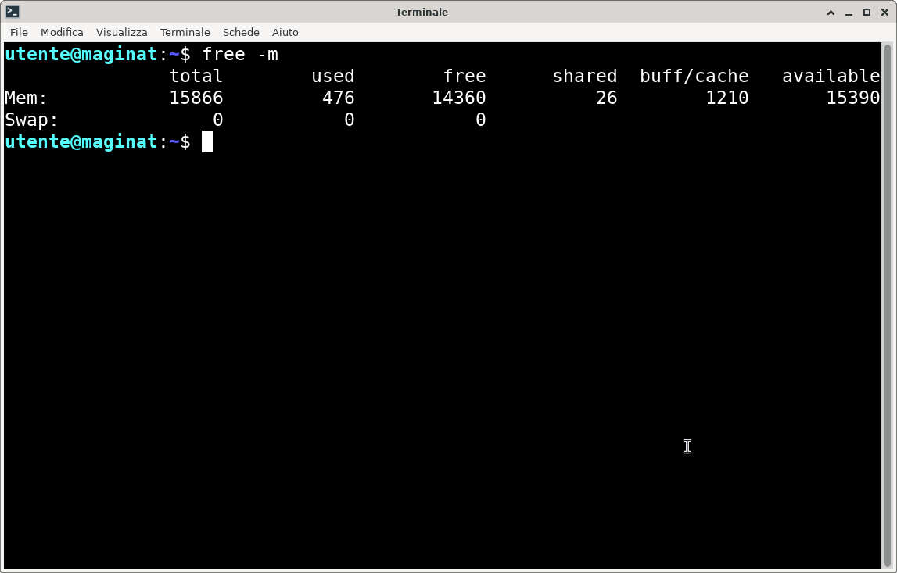

# Maginat

Distribuzione Linux indipendente costruita da zero seguendo **Linux From Scratch 12.4** (init SysV, senza systemd), con il desktop **Xfce**.

**Ultima versione: [0.1.3](https://github.com/Aleps31/Maginat/releases/tag/v0.1.3)** · Sito: https://aleps31.github.io/Maginat/ · English: [README.md](README.md) · Español: [README.es.md](README.es.md)

## Stato

Maginat 0.1.3 è una release ufficiale di un progetto giovane (serie 0.x). È stata provata in macchine virtuali (BIOS, UEFI e UEFI con Secure Boot; sessione live e installazione su un intero disco, accanto a un altro sistema, nello spazio libero di un disco, cifrata e portatile su una chiavetta USB); la sessione live ha girato anche, con Secure Boot attivo, su un Dell Vostro 15-3568 (grafica Intel).

## Schermate

## Cosa include

- Xfce con tema, cursori, barra in alto e dock personalizzati; 44 sfondi
- Mullvad Browser, LibreOffice, Tutanota Desktop, mtPaint (Thunderbird e molte altre app sono a un clic nel Negozio)
- Widget del desktop a scelta: orologio, calendario, meteo, monitor di sistema, batteria e rete, collegamenti rapidi, note
- Stampa e scansione: stampanti e scanner senza driver (USB e rete), più i driver HPLIP (solo stampa), brlaser (Brother) e splix (Samsung, Xerox, Dell, Lexmark, Toshiba)
- Wi-Fi, Bluetooth, audio e gestione energia; firewall attivo di default
- Negozio Maginat (Flatpak/Flathub) e Aggiorna Maginat
- Giochi Ventuno e Poker
- Installatore grafico per BIOS e UEFI, con presentazione e barra di avanzamento vera: cancella un intero disco, usa una partizione esistente, usa lo spazio libero di un disco (non cancella nulla) o installa su una chiavetta USB che parte su qualsiasi PC; cifratura del disco facoltativa (LUKS2)
- Interfaccia in italiano, inglese e spagnolo

## Novità della 0.1.3

- **Secure Boot**: shim e GRUB firmati (da Ubuntu 24.04), kernel firmato con la chiave di Maginat; la chiave si registra una volta per computer (vedi sotto)
- **Lockdown del kernel** attivo; kernel Linux 6.18.62 LTS ricompilato con supporto USB Attached SCSI (UAS) e con i driver Wi-Fi Broadcom più vecchi (b43, brcmsmac) come moduli
- **Aggiornamenti di sicurezza** già nella ISO (stessa serie di prima, solo correzioni): kernel Linux 6.18.62, OpenSSL 3.5.9, curl 8.23.0, OpenSSH 10.6p2, libpng 1.6.59, xz 5.8.4, git 2.47.3, zlib 1.3.2, Python 3.13.18
- **Spagnolo** aggiunto: interfaccia, app, giochi, installatore e tastiera. La lingua si sceglie nella prima schermata all'avvio
- **Sessione live come le altre distribuzioni**: parte direttamente il desktop con l'icona "Installa Maginat" (niente menu testuale)
- Nuovo **menu di avvio**: Maginat, con persistenza, grafica sicura, compatibilità, impostazioni del firmware
- **Installatore flessibile**: intero disco, partizione esistente, **spazio libero accanto a un altro sistema (dual boot)**, **riduzione di una partizione Windows o Linux per fare spazio (sperimentale)** o **installazione portatile** su una chiavetta USB (BIOS e UEFI); gli altri sistemi trovati sul disco vengono aggiunti al menu di avvio
- **Cifratura del disco (LUKS2)**, facoltativa su un intero disco, su una partizione esistente (con una piccola partizione separata per `/boot`), nello spazio libero o su una chiavetta portatile: la password viene chiesta a ogni avvio; una **chiave di recupero** (16 caratteri) viene mostrata durante l'installazione e sblocca comunque il disco
- **Aggiornamenti del sistema** in Aggiorna Maginat: pacchetti firmati (kernel compreso), kernel precedente tenuto come ripiego, **"Annulla l'ultimo aggiornamento"**, controllo giornaliero con notifica (chiede una volta, solo sistema installato)
- **Nuove versioni di Maginat senza nuova ISO**: Aggiorna Maginat può portare la 0.1.3 alle versioni successive con un pacchetto firmato; le impostazioni che hai modificato restano (la versione nuova si salva accanto come `.nuovo-…`) e l'aggiornamento si può annullare
- Avviso quando una scheda Wi-Fi ha bisogno di un firmware non installato, più l'utilità **Firmware Wi-Fi Broadcom** nel menu che lo scarica e lo installa (serve un'altra connessione a Internet)
- Utilità **Plug-in stampanti HP** nel menu: scarica sul tuo computer il plug-in proprietario di HP (richiesto da alcune stampanti), ne controlla firma e integrità, mostra la licenza di HP e lo installa (non ancora provata con una stampante HP vera)
- Le icone delle app Flatpak ora si vedono correttamente (le icone SVG vengono convertite in automatico)
- **Widget del desktop** ridisegnati, finestre e menu chiari, 44 sfondi (erano 26), "M" animata prima della schermata di accesso, nuova grafica per Ventuno e Poker
- Thunderbird non è più nella ISO (resta nel Negozio); ISO di circa 1,4 GB
- RAM a riposo: circa **270 MB** in una macchina virtuale e circa **600 MB** su un portatile reale (sessione live); circa **4,1 GB** di disco dopo l'installazione

## Download e installazione

Scarica la ISO dalla pagina [Releases](https://github.com/Aleps31/Maginat/releases), verifica lo SHA-256 (`sha256sum -c SHA256SUMS`), scrivila su una chiavetta USB (4 GB o più) e avvia. Requisiti: PC x86-64-v2 (processore del 2009 circa o più recente), 2 GB di RAM (consigliati 4 GB), almeno 20 GB di disco per installare.

| File | Note |
|---|---|
| maginat-0.1.3.iso | live + installer avviabile, circa 1,4 GB |
| maginat-sviluppo-0.1.3.tar.xz | strumenti di sviluppo, scaricati dal Negozio (non rinominare) |
| maginat-0.1.3-sources.tar | sorgenti dei pacchetti nuovi o cambiati, configurazione del kernel |
| SHA256SUMS | checksum |

Nella sessione live l'utente è `utente` e la password è `maginat` (serve solo per sbloccare lo schermo).

### Secure Boot

Maginat parte con il Secure Boot attivo. La prima volta su ogni computer bisogna registrare la chiave di Maginat (resta nel firmware e vale anche per il sistema installato):

1. Avvia la ISO. Un messaggio spiega cosa succede, poi compare una **schermata blu (MokManager)**: premi un tasto entro 10 secondi.
2. Scegli **Enroll key from disk**, seleziona `maginat-sb.cer`, poi **Continue**, **Yes**, **Reboot**.
3. Avvia di nuovo la ISO: ora parte normalmente.

Alternative: provarla in una macchina virtuale, oppure disattivare il Secure Boot nelle impostazioni del firmware. Se il tuo PC usa **BitLocker** o la cifratura del dispositivo, cambiare le impostazioni del Secure Boot può far chiedere la chiave di ripristino al prossimo avvio di Windows: tienila a portata di mano, oppure scegli la prima opzione.

## Menu di avvio

1. **Maginat 0.1.3**: avvio normale (apre la registrazione della chiave se serve)
2. **Con persistenza**: conserva i file sulla chiavetta (`sudo maginat-persistenza`)
3. **Grafica sicura**: per gli schermi che restano neri
4. **Compatibilità**: opzioni in più per hardware vecchio o particolare
5. **Impostazioni del firmware**: apre il setup UEFI (solo UEFI)

## Limiti noti

- Secure Boot: la chiave di Maginat va registrata una volta per computer. Il kernel gira in modalità lockdown: i moduli non firmati (per esempio i driver NVIDIA proprietari o i moduli host di VirtualBox) non si possono caricare e l'ibernazione non è disponibile
- Cifratura del disco (LUKS2): se dimentichi la password e perdi la chiave di recupero i dati non si possono recuperare; `/boot` non è cifrata; per cifrare una partizione esistente serve una seconda partizione (almeno 512 MiB) sullo stesso disco per `/boot`
- La riduzione di una partizione (opzione 5 dell'installatore) è **sperimentale**: funziona su partizioni NTFS (Windows) ed ext2/3/4 e ne conserva i file, ma un'interruzione di corrente o un errore possono comunque far perdere dati, quindi fai prima una copia di sicurezza. Rifiuta BitLocker, Windows ibernato (avvio rapido) e file system con errori; in quei casi libera tu lo spazio dall'altro sistema (con BitLocker, sospendilo prima)
- La password del disco si scrive con il layout scelto durante l'installazione (27 layout, soprattutto europei); per altre tastiere (per esempio greca, cirillica, lituana, lettone, rumena) scegli US e scrivila come su una tastiera americana. Può contenere solo lettere senza accenti, cifre e simboli comuni
- Non ancora supportati: driver NVIDIA proprietari, Wi-Fi Broadcom `wl` e lettori di impronte digitali (previsti per la 0.1.4)
- Installare accanto a un altro sistema modifica la tabella delle partizioni (la modalità spazio libero aggiunge soltanto partizioni): fai prima una copia dei dati importanti
- Alcune schede Wi-Fi Broadcom più vecchie richiedono un firmware non ridistribuibile (b43): Maginat avvisa quando manca e offre l'utilità **Firmware Wi-Fi Broadcom** (menu) per scaricarlo, che richiede un'altra connessione a Internet (Ethernet o tethering USB dal telefono)
- Gli aggiornamenti riguardano le app Flatpak, i pacchetti di sistema firmati e le nuove versioni di Maginat (senza nuova ISO); le impostazioni già salvate nella tua cartella personale (pannello, sfondo) non vengono cambiate da un aggiornamento di versione
- Alcune stampanti HP richiedono un plug-in proprietario di HP (non ridistribuibile): Maginat non lo contiene, ma l'utilità **Plug-in stampanti HP** (menu) lo scarica, ne controlla la firma e lo installa (serve Internet; non ancora provata con una stampante HP vera)
- Software sperimentale: non usarlo su macchine con dati senza copia di sicurezza

## Codice sorgente

Gli script di costruzione e la configurazione sono in `build/`, `system/` e nelle cartelle di ogni versione (`0.1.1/`, `0.1.2/`, `0.1.3/`: script in `build/` e file in `overlay/`). Gli archivi dei sorgenti sono allegati a ogni release: i sorgenti di base nella release 0.1, i pacchetti più recenti in quelle successive. I binari ufficiali provengono dai progetti originali elencati nell'archivio dei sorgenti.

## Crediti

Progettato e creato da **Alessandro Pisanu ("Aleps31")**, che ha costruito la base LFS e ha progettato e integrato l'intero sistema. Il codice Python, C e shell è stato scritto e corretto insieme a Claude (Anthropic).

## Licenza

Copyright (C) 2026 Alessandro Pisanu ("Aleps31"). Codice originale: GPL-2.0 (vedi `LICENSE` e `COPYRIGHT`). Chi copia, modifica o ridistribuisce Maginat deve mantenere questa nota di copyright e il testo della licenza, e pubblicare i sorgenti. Il nome "Maginat", il logo e le chiavi di firma non sono coperti dalla licenza: una versione modificata deve usare un altro nome e non può firmare aggiornamenti per Maginat. Ogni pacchetto mantiene la propria licenza (vedi `LICENZE.txt` nel sistema).

## Avvertenza

Maginat non è affiliata ai progetti che include.
