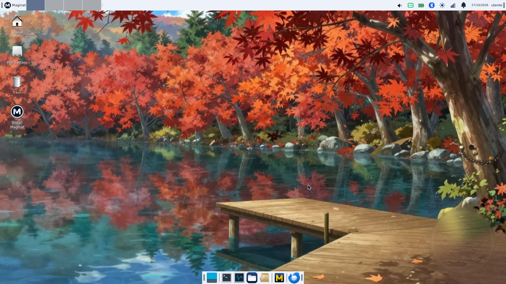
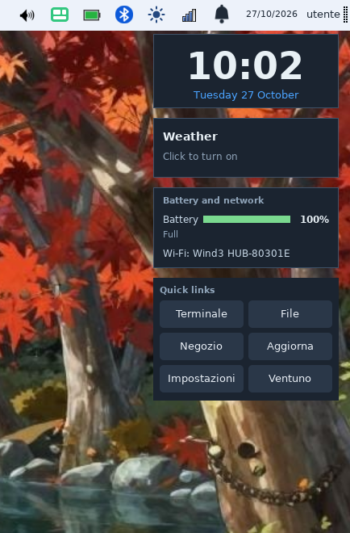
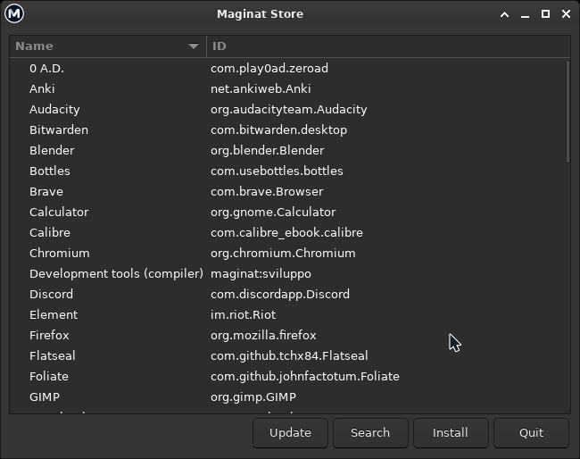

# Maginat

An independent Linux distribution built from scratch following **Linux From Scratch 12.4** (SysV init, no systemd), with the **Xfce** desktop.

**Latest release: [0.1.2](https://github.com/Aleps31/Maginat/releases/tag/v0.1.2)** (pre-release) · Website: https://aleps31.github.io/Maginat/ · Italiano: [README.it.md](README.it.md)

## Status

Maginat 0.1.2 is a preview. It has been tested in virtual machines and on one laptop (Dell Vostro 15-3568, live session from USB).

## Screenshots

## What is included

- Xfce with a custom theme, cursors, top bar and dock
- Mullvad Browser, Thunderbird, LibreOffice, Tutanota Desktop, mtPaint
- Desktop widgets of your choice: clock, calendar, weather, system monitor, battery and network, quick links, notes
- Printing and scanning (including driverless printers and scanners over USB/network)
- Wi-Fi, Bluetooth, sound and power management; firewall enabled by default
- Maginat Store (Flatpak/Flathub) and Update Maginat
- Blackjack and Poker games
- Graphical installer for BIOS and UEFI (Italian and English): choose keyboard, time zone, user name, password, and a whole disk or a single partition

## What is new in 0.1.2

- Linux kernel 6.18.58 LTS (was 6.16.1) with new drivers
- ISO down to about 1.4 GB (was 2.1 GB); the compiler is an optional download from the Store
- About 460 MB of RAM at idle (live session on real hardware)
- Desktop widgets, unified top-bar tray (volume, brightness, battery, Bluetooth), own cursor theme, animated boot splash, 26 wallpapers
- "Safe graphics" boot entry now working
- Fn volume keys work; the battery icon opens the power settings
- Update Maginat: updates Flatpak apps, checks GitHub for newer releases and installs signed system updates (kernel and packages) on installed systems
- Bigger Store; new Blackjack and Poker with animations and automatic next hand
- Driverless printing and scanning (ipp-usb, sane-airscan)
- USB drives of any format (including NTFS and exFAT) mount out of the box, with a plug-in notification; automatic suspend on critically low battery

## Download and installation

Get the ISO from the [Releases](https://github.com/Aleps31/Maginat/releases) page, verify its SHA-256 (`sha256sum -c SHA256SUMS`), write it to a USB stick and boot it. Secure Boot must be disabled.

| File | Notes |
|---|---|
| maginat-0.1.2.iso | bootable live + installer |
| maginat-sviluppo-0.1.2.tar.xz | development tools, downloaded by the Store (do not rename) |
| maginat-0.1.2-sources.tar | sources of new or changed packages, kernel config |
| SHA256SUMS | checksums |

## Known limitations

- No Secure Boot (disable it in the firmware to boot the ISO)
- System updates (kernel and packages, signed) from Update Maginat on installed systems; a new Maginat version still means downloading the new ISO. Store apps update with Update Maginat too
- Some Flatpak icons may look generic (no SVG icon support yet), and tray icons do not use the StatusNotifier standard yet
- No proprietary printer drivers (for example HPLIP): IPP printers and driverless scanning work
- X11 only, no Wayland

## Source code

Our build scripts and configuration are in the folders named after each version (`0.1/`: `build/` and `system/`; `0.1.1/` and `0.1.2/`: `build/` scripts and `overlay/` files). Source archives are attached to each release: the base sources are in the 0.1 release, newer packages in the later ones. Official binaries come from the upstream projects listed in the sources archive.

## Credits

Created by Aleps31. The LFS base, the Python code and the desktop integration were built by the author; scripts were developed with Claude (Anthropic).

## License

Original code: GPL-2.0 (see `LICENSE`). Every package keeps its own license (see `LICENZE.txt` in the system).

## Disclaimer

Maginat is not affiliated with the projects it includes.
