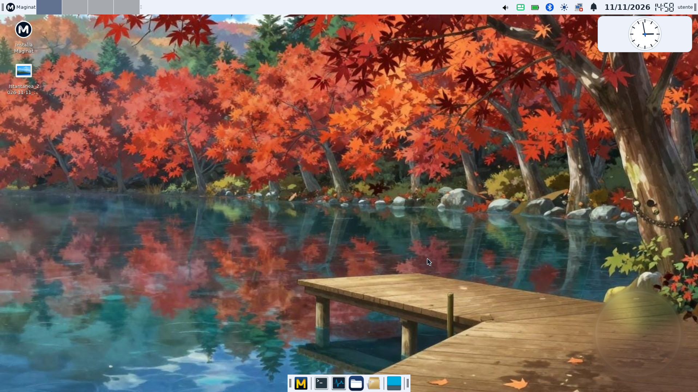
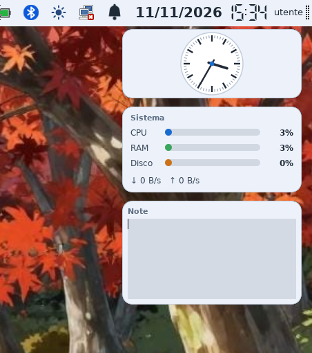
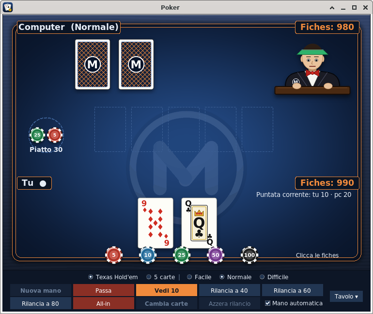
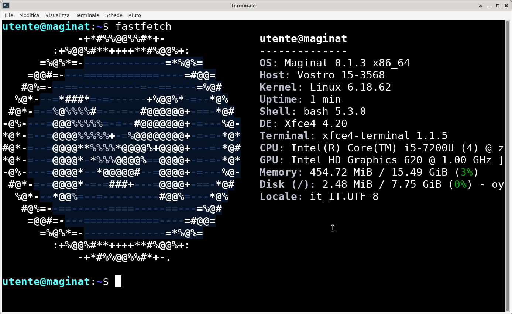
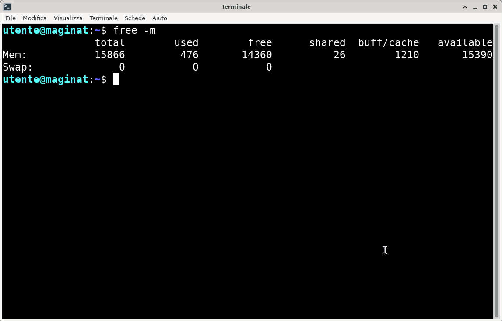

# Maginat

An independent Linux distribution built from scratch following **Linux From Scratch 12.4** (SysV init, no systemd), with the **Xfce** desktop.

**Latest release: [0.1.3](https://github.com/Aleps31/Maginat/releases/tag/v0.1.3)** · Website: https://aleps31.github.io/Maginat/ · Italiano: [README.it.md](README.it.md) · Español: [README.es.md](README.es.md)

## Status

Maginat 0.1.3 is an official release of a young project (0.x series). It has been tested in virtual machines (BIOS, UEFI and UEFI with Secure Boot; live session and installation on a whole disk, next to another system, in the free space of a disk, encrypted, and portable on a USB drive); the live session also ran, with Secure Boot on, on a Dell Vostro 15-3568 (Intel graphics).

## Screenshots

## What is included

- Xfce with a custom theme, cursors, top bar and dock; 44 wallpapers
- Mullvad Browser, LibreOffice, Tutanota Desktop, mtPaint (Thunderbird and many more apps are one click away in the Store)
- Desktop widgets of your choice: clock, calendar, weather, system monitor, battery and network, quick links, notes
- Printing and scanning: driverless printers and scanners (USB/network), plus HPLIP (print only), brlaser (Brother) and splix (Samsung, Xerox, Dell, Lexmark, Toshiba) drivers
- Wi-Fi, Bluetooth, sound and power management; firewall enabled by default
- Maginat Store (Flatpak/Flathub) and Update Maginat
- Blackjack and Poker games
- Graphical installer for BIOS and UEFI, with a slideshow and a real progress bar: erase a whole disk, use an existing partition, use the free space of a disk (nothing is erased) or install on a USB drive that boots on any PC; optional disk encryption (LUKS2)
- Interface in English, Italian and Spanish

## What is new in 0.1.3

- **Secure Boot**: signed shim and GRUB (from Ubuntu 24.04), kernel signed with the Maginat key; the key is enrolled once per computer (see below)
- **Kernel lockdown** enabled; Linux kernel 6.18.62 LTS rebuilt with USB Attached SCSI (UAS) support and older Broadcom Wi-Fi drivers (b43, brcmsmac) as modules
- **Security updates** already in the ISO (same series as before, fixes only): Linux kernel 6.18.62, OpenSSL 3.5.9, curl 8.23.0, OpenSSH 10.6p2, libpng 1.6.59, xz 5.8.4, git 2.47.3, zlib 1.3.2, Python 3.13.18
- **Spanish** added: interface, apps, games, installer and keyboard. The language is chosen in the first boot screen
- **Live session like other distros**: it goes straight to the desktop with an "Install Maginat" icon (no text menu)
- New **boot menu**: Maginat, with persistence, safe graphics, compatibility, firmware settings
- **Flexible installer**: whole disk, existing partition, **free space next to another system (dual boot)**, **shrinking a Windows or Linux partition to make room (experimental)** or **portable installation** on a USB drive (BIOS and UEFI); other systems found on the disk are added to the boot menu
- **Disk encryption (LUKS2)**, optional on a whole disk, on an existing partition (with a small separate partition for `/boot`), in free space or on a portable USB drive: the password is asked at every start; a **recovery key** (16 characters) is shown at install time and also unlocks the disk
- **System updates** in Update Maginat: signed packages (including the kernel), the previous kernel kept as a fallback, **"Undo last update"**, a daily check with a notification (asks once, installed system only)
- **New Maginat versions without a new ISO**: Update Maginat can move 0.1.3 to later versions with a signed package; settings you changed are kept (the new version is saved next to them as `.nuovo-…`) and the update can be undone
- Warning when a Wi-Fi card needs firmware that is not installed, plus a **Broadcom Wi-Fi firmware** utility in the menu that downloads and installs it (it needs another Internet connection)
- **HP printer plug-in** utility in the menu: downloads HP's proprietary plug-in (needed by some printers) on your computer, checks its signature and integrity, shows HP's license and installs it (not yet tested with a real HP printer)
- Flatpak app icons now display correctly (SVG icons are converted automatically)
- Redesigned **desktop widgets**, light windows and menus, 44 wallpapers (was 26), animated boot "M" before the login screen, new Blackjack and Poker graphics
- Thunderbird is no longer on the ISO (still in the Store); ISO about 1.4 GB
- RAM at idle: about **270 MB** in a virtual machine and about **600 MB** on a real laptop (live session); about **4.1 GB** of disk after installation

## Download and installation

Get the ISO from the [Releases](https://github.com/Aleps31/Maginat/releases) page, verify its SHA-256 (`sha256sum -c SHA256SUMS`), write it to a USB stick (4 GB or more) and boot it. Requirements: x86-64-v2 PC (processor from about 2009 or newer), 2 GB of RAM (4 GB recommended), at least 20 GB of disk to install.

| File | Notes |
|---|---|
| maginat-0.1.3.iso | bootable live + installer, about 1.4 GB |
| maginat-sviluppo-0.1.3.tar.xz | development tools, downloaded by the Store (do not rename) |
| maginat-0.1.3-sources.tar | sources of new or changed packages, kernel config |
| SHA256SUMS | checksums |

In the live session the user is `utente` and the password is `maginat` (only needed to unlock the screen).

### Secure Boot

Maginat boots with Secure Boot on. The first time on each computer you must enroll the Maginat key (it stays in the firmware, it also covers the installed system):

1. Boot the ISO. A message explains what is going on, then a **blue screen (MokManager)** appears: press a key within 10 seconds.
2. Choose **Enroll key from disk**, select `maginat-sb.cer`, then **Continue**, **Yes**, **Reboot**.
3. Boot the ISO again: now it starts normally.

Alternatives: try it in a virtual machine, or turn Secure Boot off in the firmware settings. If your PC uses **BitLocker** or device encryption, changing Secure Boot settings can ask for the recovery key at the next Windows start: have it ready, or prefer the first option.

## Boot menu

1. **Maginat 0.1.3**: normal start (opens the key enrollment if needed)
2. **With persistence**: keeps your files on the USB stick (`sudo maginat-persistenza`)
3. **Safe graphics**: for screens that stay black
4. **Compatibility**: extra options for old or unusual hardware
5. **Firmware settings**: opens the UEFI setup (UEFI only)

## Known limitations

- Secure Boot: the Maginat key must be enrolled once per computer. The kernel runs in lockdown mode: unsigned modules (for example proprietary NVIDIA drivers or VirtualBox host modules) cannot be loaded, and hibernation is not available
- Disk encryption (LUKS2): if you forget the password and lose the recovery key the data cannot be recovered; `/boot` is not encrypted; encrypting an existing partition needs a second partition (at least 512 MiB) on the same disk for `/boot`
- Shrinking a partition (installer option 5) is **experimental**: it works on NTFS (Windows) and ext2/3/4 partitions, keeps their files, but a power cut or an error can still lose data, so back up first. It refuses BitLocker, hibernated Windows (Fast Startup) and file systems with errors; in those cases free some space from the other system yourself (with BitLocker, suspend it before)
- The disk password is typed with the keyboard layout chosen at installation (27 layouts, mostly European); for other keyboards (for example Greek, Cyrillic, Lithuanian, Latvian, Romanian) choose US and type it as on an American keyboard. It can only contain letters without accents, digits and common symbols
- Not supported yet: proprietary NVIDIA drivers, Broadcom `wl` Wi-Fi and fingerprint readers (planned for 0.1.4)
- Installing next to another system changes the partition table (free-space mode only adds partitions): back up important data first
- Some older Broadcom Wi-Fi cards need firmware that cannot be redistributed (b43): Maginat tells you when it is missing and offers the **Broadcom Wi-Fi firmware** utility (menu) to download it, which needs another Internet connection (Ethernet or phone USB tethering)
- Updates cover Flatpak apps, signed system packages and new Maginat versions (no new ISO needed); settings already saved in your home folder (panel, wallpaper) are not changed by a version update
- Some HP printers need a proprietary HP plug-in (not redistributable): Maginat does not contain it, but the **HP printer plug-in** utility (menu) downloads it, checks its signature and installs it (needs Internet; not yet tested with a real HP printer)
- Experimental software: do not use it on machines with data you cannot lose without a backup

## Source code

Our build scripts and configuration are in `build/`, `system/` and in the folders named after each version (`0.1.1/`, `0.1.2/`, `0.1.3/`: `build/` scripts and `overlay/` files). Source archives are attached to each release: the base sources are in the 0.1 release, newer packages in the later ones. Official binaries come from the upstream projects listed in the sources archive.

## Credits

Designed and created by **Alessandro Pisanu ("Aleps31")**, who built the LFS base and designed and integrated the whole system. The Python, C and shell code was written and fixed together with Claude (Anthropic).

## License

Copyright (C) 2026 Alessandro Pisanu ("Aleps31"). Original code: GPL-2.0 (see `LICENSE` and `COPYRIGHT`). Anyone who copies, modifies or redistributes Maginat must keep this copyright notice and the license text, and publish the sources. The name "Maginat", its logo and its signing keys are not covered by the license: a modified version must use another name and cannot sign updates for Maginat. Every package keeps its own license (see `LICENZE.txt` in the system).

## Disclaimer

Maginat is not affiliated with the projects it includes.
